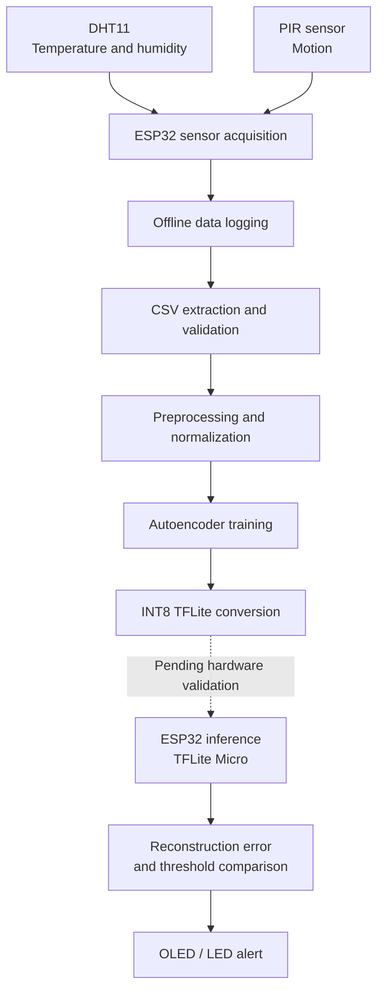

# TinyML Environmental Anomaly Detection on ESP32

**An embedded machine-learning project exploring unsupervised environmental anomaly detection under microcontroller constraints.**

This project combines real sensor-data acquisition, lightweight neural-network training, INT8 quantization, and an ESP32-based deployment workflow. The objective is to identify unusual indoor environmental observations using temperature, humidity, and motion data, without relying on cloud inference or labeled anomalies during training.

> **Project status:** Real sensor-data acquisition, model training, and INT8 conversion have been completed for the current experiment. Reliable anomaly detection and on-device inference have not yet been validated.

## Overview

| Category | Details |
|---|---|
| Target platform | ESP32 development board |
| Sensors | DHT11 temperature/humidity, HC-SR501 PIR |
| Input features | Temperature, relative humidity, motion |
| ML approach | Unsupervised reconstruction-based anomaly detection |
| Architecture | Dense autoencoder: `3 → 8 → 2 → 8 → 3` |
| Trainable parameters | 101 |
| Quantization | INT8 TensorFlow Lite |
| Current INT8 model size | 3,440 bytes |
| Training data | Real readings collected using the ESP32 |
| Intended inference | Local execution using TensorFlow Lite Micro |
| Cloud dependency | None intended for inference |

## Why this project?

Conventional environmental monitoring often relies on fixed thresholds, such as triggering an alert when temperature exceeds a predefined limit. Although useful, independent thresholds do not capture every unusual pattern in multiple sensor signals.

This project investigates whether a compact autoencoder can learn typical environmental observations and identify deviations through reconstruction error.

The challenge extends beyond model training. An embedded anomaly-detection system must also handle sensor acquisition, preprocessing, threshold calibration, quantization effects, memory constraints, and false alarms.

The project therefore follows an experimental workflow: collect real data, train and evaluate a compact model, convert it to INT8, and validate its performance on the target hardware.

## System architecture

The diagram separates the implemented data and model-development workflow from the remaining deployment work.



**Implemented:** sensor acquisition, offline logging, data extraction, session inspection, model training, and INT8 model conversion.

**Still in progress:** validated on-device inference, embedded anomaly scoring, alert behavior, and end-to-end performance evaluation.

The OLED and LED are part of the intended hardware design; their integration with the complete inference pipeline is not yet claimed as validated.

## Hardware

| Component | Purpose | Interface |
|---|---|---|
| ESP32 DevKit | Sensor acquisition and target inference platform | — |
| DHT11 module | Temperature and relative humidity | GPIO 4 |
| HC-SR501 PIR | Motion detection | GPIO 27 |
| SSD1306 128×64 OLED | Intended status display | I²C, GPIO 21/22 |
| LED with 220 Ω resistor | Intended visual indicator | GPIO 26 |

The initial design considered an LDR light sensor, but a usable module was unavailable. The current implementation therefore uses three input features rather than four.

See [`docs/wiring.md`](docs/wiring.md) for wiring details and design notes.

## Machine-learning methodology

### Input features

Each observation contains three features:

- `temp_c`: temperature in degrees Celsius.
- `hum_pct`: relative humidity in percent.
- `motion`: binary motion indication within the sampling window.

The current sampling interval is five seconds. Motion is represented as a binary event within each window, rather than as a detailed movement signal.

### Autoencoder architecture

```text
Input (3 features)
       │
       ▼
   Dense (8)
       │
       ▼
 Latent space (2)
       │
       ▼
   Dense (8)
       │
       ▼
Output (3 features)
```

The autoencoder learns to reconstruct observations from the training distribution. Its two-unit bottleneck compresses the three input features into a lower-dimensional representation.

At inference time, the intended anomaly score is the mean squared reconstruction error:

\[
\operatorname{MSE}(x,\hat{x}) =
\frac{1}{3}\sum_{i=1}^{3}(x_i-\hat{x}_i)^2
\]

An observation is flagged when its reconstruction error exceeds a threshold, \(\tau\).

### Threshold calibration

The current floating-point threshold is selected as the 95th percentile of reconstruction errors on held-out validation data.

This percentile is a calibration choice, not a guarantee that future normal observations will have a 5% false-positive rate. Performance can change across recording sessions and environmental conditions.

The INT8 model has a different reconstruction-error distribution and therefore requires its own threshold calibration and evaluation.

### Training and quantization

Model development takes place on a computer using recorded ESP32 sensor data. The trained autoencoder is converted to an INT8 TensorFlow Lite model for the intended embedded deployment.

The eventual on-device pipeline must apply the same preprocessing parameters used during training, correctly handle quantization and dequantization, calculate the reconstruction error, and compare it against the appropriate threshold.

TensorFlow Lite Micro is the intended inference runtime. Running the exported model on the ESP32, however, remains a separate implementation and validation task.

See [`docs/methodology.md`](docs/methodology.md) for further implementation details.

## Experimental results

The following results describe the current experiment trained on four previously collected real-data sessions. The later `offline_test.csv` recording is not included in these training results.

### Dataset and training

| Metric | Result |
|---|---:|
| Usable observations | 6,913 |
| Approximate recorded duration | 9.6 hours |
| Training observations | 5,040 |
| Validation observations | 1,080 |
| Test observations | 793 |
| Training epochs | 124 |
| Best validation loss | \(1.16 \times 10^{-3}\) |
| Trainable parameters | 101 |

The data was collected in multiple sessions. The dataset does not yet represent a complete day/night cycle, and it does not provide a comprehensive labeled benchmark of environmental anomalies.

### INT8 conversion

| Metric | Float model | INT8 model |
|---|---:|---:|
| Median validation reconstruction error | \(8.26 \times 10^{-5}\) | \(2.10 \times 10^{-3}\) |
| 95th-percentile validation reconstruction error | \(4.54 \times 10^{-3}\) | \(5.73 \times 10^{-3}\) |
| Exported model file size | — | 3,440 bytes |

The per-sample reconstruction-error correlation between the float and INT8 models was **0.9219**.

Quantization successfully produced a compact INT8 artifact, but it also changed the reconstruction-error distribution. Threshold selection must therefore be evaluated independently for the quantized model.

The reported 3,440 bytes is the model file size only. It does not represent the complete firmware size, runtime memory consumption, TensorFlow Lite Micro tensor-arena requirements, or inference latency.

### Evaluation and current limitation

The current floating-point model produced a **28.2% false-positive rate on held-out normal test observations**, using the threshold selected from validation data.

This result is too high for a reliable environmental anomaly detector and is a key limitation of the current experiment.

The INT8 model also produced a 28.2% false-positive rate on the same normal test observations when evaluated with its own calibrated threshold. Using the floating-point threshold directly on the INT8 model increased the false-positive rate to 30.1%.

These findings motivate further work on:

- Collecting more representative normal operating data.
- Investigating differences between sessions and environmental drift.
- Improving threshold stability and generalization.
- Evaluating controlled, labeled disturbances.
- Comparing the autoencoder with simpler statistical baselines.

No anomaly detection rate or recall is reported yet because a labeled real-world anomaly evaluation has not been completed.

## Repository structure

```text
tinyml-env-anomaly/
├── firmware/
│   ├── data_logger/
│   │   └── data_logger.ino
│   └── offline_logger/
│       └── offline_logger.ino
├── ml/
│   ├── train_autoencoder.py
│   └── convert_tflite.py
├── tools/
│   ├── check_session.py
│   ├── fake_esp32.py
│   ├── offline_dump.py
│   ├── reanchor_session.py
│   └── serial_logger.py
├── docs/
│   ├── methodology.md
│   └── wiring.md
├── data/
│   └── raw/               # Local sensor recordings
├── models/
│   ├── scratch/           # Current real-data experiment
│   └── synthetic/         # Synthetic development experiment
├── requirements.txt
└── README.md
```

The exact role of each firmware sketch should be confirmed from its source before changing or flashing firmware. Synthetic data generated by `tools/fake_esp32.py` is intended for development and must not be presented as real hardware measurements.

Raw recordings and generated model artifacts are local experimental data. They do not need to be committed to the public repository unless there is a deliberate decision to publish selected, reviewed artifacts.

## Reproducing the current experiment

The commands below describe the workflow used for the current experiment. They assume the original four CSV files are present locally.

### 1. Set up the environment

The current experiment used Python 3.12.10 and TensorFlow 2.21.0.

```powershell
py -3.12 -m venv .venv
.venv\Scripts\Activate.ps1
python -m pip install --upgrade pip
pip install -r requirements.txt
```

### 2. Extract data from the ESP32

Connect the ESP32 and identify the correct serial port. For example:

```powershell
python tools/offline_dump.py --port COM4 --out data/raw/session.csv
```

If the actual local recording start time is known, use `--start` to anchor the timestamps:

```powershell
python tools/offline_dump.py --port COM4 --start "YYYY-MM-DD HH:MM:SS" --out data/raw/session.csv
```

Replace the placeholder with the actual local date and time. Without `--start`, the tool warns that the timestamps are approximate.

**Data safety:** Avoid `--erase` until the exported CSV has been checked and backed up. The option erases the stored board log; it does not delete the exported CSV.

### 3. Inspect a recording

```powershell
python tools/check_session.py data/raw/session.csv
```

Review the number of rows, timing gaps, detected reboots, missing fields, and sensor ranges before using a session for training.

### 4. Train the autoencoder

The following command reproduces the existing experiment when the four listed files are present:

```powershell
$files = @(
    "data/raw/session_20261024_234018.csv",
    "data/raw/session_20261025_134557.csv",
    "data/raw/classroom_raw_20261026.csv",
    "data/raw/session_20261026_105615_reading_room.csv"
)

python ml/train_autoencoder.py --train $files --outdir models/scratch
```

These filenames identify the sessions used for the reported results. If you use additional recordings, evaluate them as a separate experiment and update the reported metrics only after rerunning the appropriate pipeline.

### 5. Convert the model to INT8

```powershell
python ml/convert_tflite.py --train $files --model-dir models/scratch
```

The current workflow produces the INT8 TFLite artifact and associated model parameters, normalization information, and threshold artifacts under the selected model directory.

Successful conversion verifies that the model artifact was generated. It does not verify embedded inference or real-time anomaly detection on the ESP32.

## Development roadmap

- [x] Sensor wiring and hardware bring-up.
- [x] ESP32 sensor-data logging.
- [x] Offline extraction of stored sensor readings.
- [x] CSV session inspection and data-quality checks.
- [x] Training a three-feature autoencoder on real sensor data.
- [x] Generating an INT8 TensorFlow Lite model.
- [x] Comparing float and INT8 reconstruction errors.
- [ ] Collecting a longer and more representative normal dataset.
- [ ] Recording controlled disturbances with event timestamps and labels.
- [ ] Evaluating false positives and anomaly detection performance on labeled data.
- [ ] Comparing the autoencoder against PCA and Mahalanobis baselines.
- [ ] Implementing and validating TensorFlow Lite Micro inference on the ESP32.
- [ ] Verifying on-device preprocessing, quantization, thresholding, and alert behavior.
- [ ] Measuring embedded runtime memory usage and inference latency.
- [ ] Investigating the benefit of adding a light sensor.

## Known limitations

- **Limited sensor set:** The current model uses temperature, humidity, and binary motion. Light-level context is unavailable.
- **Sensor resolution:** The DHT11 provides relatively coarse measurements, limiting the detail available to the model.
- **Limited recording duration:** The current training dataset covers approximately 9.6 hours across multiple sessions rather than a complete day/night cycle.
- **High false-positive rate:** The current held-out normal test false-positive rate is 28.2%, so reliable detection has not yet been demonstrated.
- **No labeled anomaly benchmark:** Controlled and timestamped disturbances are needed to measure detection performance meaningfully.
- **No verified on-device inference:** The INT8 model has been exported but has not yet been validated as an inference pipeline running on the ESP32.
- **Unmeasured embedded resource usage:** Runtime memory, tensor-arena requirements, and inference latency remain to be measured.
- **Quantization effects:** INT8 conversion changes reconstruction errors and requires appropriate threshold calibration.

## Future work

The next phase prioritizes evaluation quality and deployment validation over increasing model complexity:

1. Collect controlled, labeled environmental disturbances.
2. Investigate false positives across sessions and environmental drift.
3. Compare the autoencoder against lightweight statistical baselines.
4. Validate floating-point and INT8 behavior on the target hardware.
5. Measure the actual embedded memory and latency footprint.
6. Evaluate whether additional sensing improves detection enough to justify its hardware cost.

The long-term objective is a reproducible, resource-conscious embedded ML system whose behavior is evaluated on real sensor data and whose hardware constraints are explicitly measured and documented.
