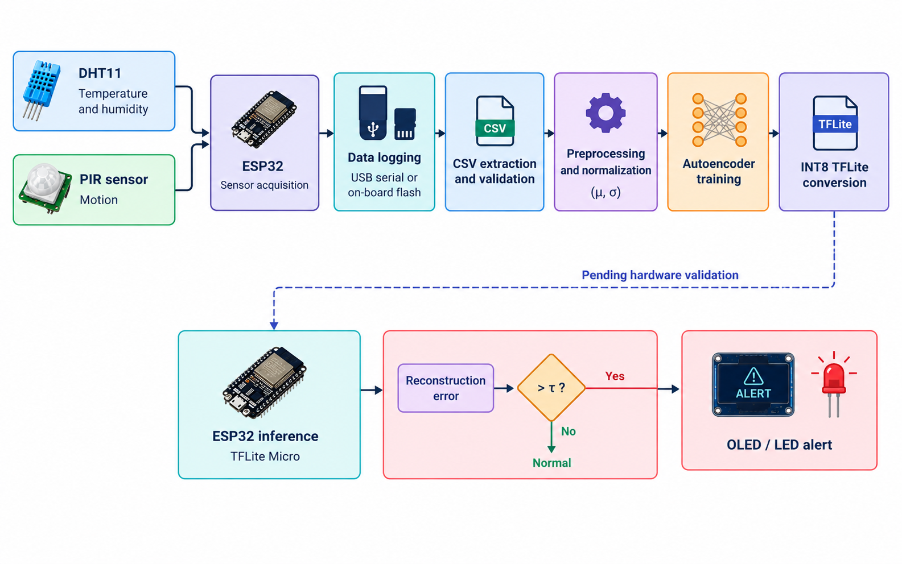
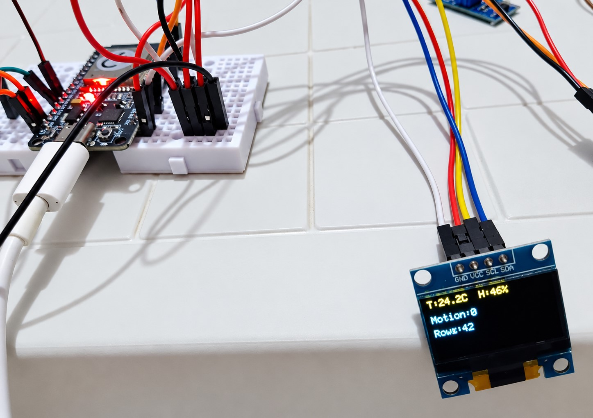

# TinyML Environmental Anomaly Detection on ESP32

**An end-to-end embedded machine-learning project: unsupervised anomaly detection for indoor environmental data, designed to run on a microcontroller.**

A compact autoencoder (101 parameters, 3,440 bytes as an INT8 TensorFlow Lite model) learns what normal temperature, humidity and motion readings look like and flags deviations through reconstruction error. The goal is local inference on an ESP32, with no cloud connection and no labeled anomalies during training.

> **Project status (27 Oct 2026):** data acquisition, model training and INT8 conversion are complete for the current experiment. Labeled evaluation and on-device inference are the next milestones and are not yet validated.

## Overview

| Category | Details |
|---|---|
| Target platform | ESP32 development board |
| Sensors | DHT11 temperature/humidity, HC-SR501 PIR |
| Input features | Temperature, relative humidity, motion |
| ML approach | Unsupervised reconstruction-based anomaly detection |
| Architecture | Dense autoencoder: `3 → 8 → 2 → 8 → 3` |
| Trainable parameters | 101 |
| Quantization | INT8 TensorFlow Lite |
| Current INT8 model size | 3,440 bytes (model file only) |
| Training data | Real readings recorded with the ESP32 (9.6 hours, 4 sessions) |
| Intended inference | Local execution using TensorFlow Lite Micro |
| Cloud dependency | None intended for inference |

## Highlights

- **End-to-end workflow:** from sensor logging on the ESP32 to a quantized model and exported firmware constants, with every step scripted and reproducible.
- **Standalone data logger:** firmware that stores checksummed 32-byte records in the board's flash, so it can record without a PC. A 4.6-hour run was extracted with no record failing its checksum.
- **Data-quality tooling:** session reports that detect gaps, reboots and damaged values. They exposed corrupted timestamps on the USB serial path, which motivated checksumming the stored records.
- **Careful evaluation:** block-wise data split, per-block false-alarm diagnostics, and a separate threshold calibrated on the INT8 model.

## Why this project?

Environmental monitoring often relies on fixed thresholds, such as an alert when temperature exceeds a limit. Independent thresholds do not capture every unusual pattern across several sensor signals.

This project investigates whether a compact autoencoder can learn typical environmental observations and flag deviations through reconstruction error. The challenge extends beyond model training: an embedded system must also handle sensor acquisition, preprocessing, threshold calibration, quantization effects, memory limits and false alarms.

## System architecture



*Pipeline overview (illustration). The dashed path, on-device inference and alerting, is the part still pending hardware validation.*

**Implemented:** sensor acquisition, data logging, data extraction, session inspection, model training and INT8 model conversion.

**Next:** validated on-device inference, embedded anomaly scoring, alert behavior and end-to-end evaluation. The OLED and LED are part of the intended design; their integration with the inference pipeline is not yet claimed as validated.

## Hardware

| Component | Purpose | Interface |
|---|---|---|
| ESP32 DevKit | Sensor acquisition and target inference platform | — |
| DHT11 module | Temperature and relative humidity | GPIO 4 |
| HC-SR501 PIR | Motion detection | GPIO 27 |
| SSD1306 128×64 OLED | Status display | I²C, GPIO 21/22 |
| LED with 220 Ω resistor | Heartbeat in the loggers; planned anomaly alert | GPIO 26 |

The initial design included an LDR light sensor, but no usable module was available, so the current implementation uses three input features instead of four. See [`docs/wiring.md`](docs/wiring.md) for wiring details.


*Prototype running the USB data logger: the OLED shows live temperature, humidity, the motion flag and the row count.*
### Firmware

| Sketch | Purpose |
|---|---|
| `firmware/data_logger/data_logger.ino` | Streams one CSV row every 5 s over USB serial; recorded on the PC with `tools/serial_logger.py` |
| `firmware/offline_logger/offline_logger.ino` | Stores checksummed records in the ESP32's flash so the board can log without a PC; extracted afterwards with `tools/offline_dump.py` |

## Dataset

All data was recorded with this hardware, one sample every five seconds.

| Session file | Date | Logging method | Usable rows | Setting |
|---|---|---|---:|---|
| `session_20261024_234018.csv` | 24 Oct 2026, night | USB serial | 941 | Quiet private room |
| `session_20261025_134557.csv` | 25 Oct 2026, afternoon | USB serial | 1,772 | Quiet private room |
| `classroom_raw_20261026.csv` | 26 Oct 2026 | On-board flash | 900 | Occupied room |
| `session_20261026_105615_reading_room.csv` | 26 Oct 2026, 10:56–15:33 | On-board flash | 3,300 | Occupied reading room |

Usable rows are counted after discarding the first 12 samples after every reboot. Notes:

- The reading-room session was recorded with the board connected to a laptop while running the offline firmware; the readings were extracted from the board's flash afterwards. Humidity fell steadily from about 43% to 29% over its 4.6 hours.
- In the second session, 25 `t_ms` values were damaged in transit over USB serial; the measurements themselves were intact. The offline logger avoids this class of error by checksumming each stored record.
- `classroom_raw_20261026.csv` was extracted without a start time, so its clock timestamps are approximate. Training does not use clock time.
- A later full dump of the board's flash is a superset of the reading-room session and is deliberately not used for training, to avoid duplicate rows.
- Per-session recording notes are in `data/raw/`.

## Machine-learning methodology

### Input features

- `temp_c`: temperature in degrees Celsius.
- `hum_pct`: relative humidity in percent.
- `motion`: binary indication of any motion within the 5-second window.

### Autoencoder architecture

```text
Input (3 features)
       │
       ▼
   Dense (8)
       │
       ▼
 Latent space (2)
       │
       ▼
   Dense (8)
       │
       ▼
Output (3 features)
```

The autoencoder learns to reconstruct observations from the training distribution. Its two-unit bottleneck compresses the three inputs into a lower-dimensional representation.

The anomaly score is the mean squared reconstruction error over the three normalized features:

```text
MSE(x, x̂) = (1/3) · Σ (xᵢ − x̂ᵢ)²      for i = 1..3
```

An observation is flagged when its score exceeds a threshold τ.

### Data split and threshold calibration

The concatenated recordings are cut into contiguous 15-minute blocks (180 samples), which are assigned 70 / 15 / 15 to training, validation and test sets. The threshold is the 95th percentile of the reconstruction error on the validation blocks. Because neighbouring blocks are correlated, this test is optimistic about generalization to new days; a whole-session hold-out is planned.

The 95th percentile is a calibration choice, not a guarantee that future normal observations will have a 5% false-positive rate. The INT8 model has a different error distribution and needs its own threshold.

### Training and quantization

Training takes place on a computer using the recorded data. The trained model is converted to INT8 with a representative dataset, and the threshold is recomputed on the quantized model. The on-device pipeline must apply the same normalization parameters, handle quantization and dequantization, compute the reconstruction error and compare it with the INT8 threshold. TensorFlow Lite Micro is the intended runtime.

See [`docs/methodology.md`](docs/methodology.md) for details.

## Preliminary results

Results below correspond to the repository tag `v0.1` and the four sessions above (9.6 hours). They will be regenerated when sessions are added.

### Training

| Metric | Result |
|---|---:|
| Usable observations | 6,913 |
| Training / validation / test | 5,040 / 1,080 / 793 |
| Training epochs | 124 |
| Best validation loss | 1.16 × 10⁻³ |

### INT8 conversion

| Metric | Float model | INT8 model |
|---|---:|---:|
| Median validation reconstruction error | 8.26 × 10⁻⁵ | 2.10 × 10⁻³ |
| 95th-percentile validation error (threshold) | 4.54 × 10⁻³ | 5.73 × 10⁻³ |
| Model file size | — | 3,440 bytes |

The per-sample error correlation between the float and INT8 models is 0.9219. Quantization raised the typical error substantially, so the INT8 model uses its own threshold. The 3,440 bytes is the model file only; firmware size, tensor-arena memory and inference latency will be measured on the device.

### False alarms on normal data

The held-out normal test set gave a **28.2% false-positive rate** for the float model and also 28.2% for the INT8 model with its own threshold (30.1% if the float threshold is reused).

The false alarms are concentrated rather than spread evenly. The three test blocks from the classroom session exceeded the threshold 5–6% of the time, close to the 5% target, while the last two test blocks (the final ~21 minutes of the reading-room session) exceeded it 67% and 100% of the time. That period is also the driest air in the dataset (mean humidity about 31% and 29% in its last two 15-minute blocks, versus 32% or higher in all earlier blocks). This is consistent with drift beyond the range seen in training; it has not been verified yet.

A detection rate and recall will be reported once the labeled controlled-disturbance recordings have been evaluated.

## Scope and limitations

- **Sensing scope:** temperature, humidity and a binary motion flag. The DHT11 is coarse (about ±2 °C and ±5 %RH accuracy; humidity changes in 1 %RH steps). A light sensor can be added through a configuration change.
- **Data scope:** 9.6 hours across four sessions and two kinds of setting, without a full day/night cycle. The test uses blocks from the same sessions, so it is optimistic about new days and new places.
- **Drift:** slow changes in the environment can move readings outside the training range and raise the false-alarm rate, as seen above.
- **Evaluation status:** no labeled anomalies have been evaluated yet, so no detection rate is claimed.

## Repository structure

```text
tinyml-env-anomaly/
├── firmware/
│   ├── data_logger/data_logger.ino
│   └── offline_logger/offline_logger.ino
├── ml/
│   ├── train_autoencoder.py
│   └── convert_tflite.py
├── tools/
│   ├── serial_logger.py     # record rows streamed over USB serial
│   ├── offline_dump.py      # extract rows stored in the board's flash
│   ├── reanchor_session.py  # fix timestamps of a dump made without --start
│   ├── check_session.py     # data-quality report for a session CSV
│   └── fake_esp32.py        # synthetic data generator (development only)
├── docs/
│   ├── images/              # figures
│   ├── methodology.md
│   └── wiring.md
├── data/raw/                # recorded sessions and notes
├── requirements.txt
└── README.md
```

Models are generated locally and not tracked. Synthetic data from `tools/fake_esp32.py` is for development only and must never be presented as real measurements.

## Reproducing the current experiment

### 1. Set up the environment

Tested with Python 3.12.10 and TensorFlow 2.21.0.

```powershell
py -3.12 -m venv .venv
.venv\Scripts\Activate.ps1
python -m pip install --upgrade pip
pip install -r requirements.txt
```

### 2. Record data

**Option A: USB serial.** Flash `data_logger.ino`, then:

```powershell
python tools/serial_logger.py --port COM4
```

**Option B: standalone.** Flash `offline_logger.ino` and power the board from USB or a power bank. Note the exact time you power it on, then extract the rows:

```powershell
python tools/offline_dump.py --port COM4 --start "YYYY-MM-DD HH:MM:SS" --out data/raw/session.csv
```

Use the real local date and time of power-on. Without `--start`, timestamps are approximate.

> **Important:** do not run `serial_logger.py` with the offline firmware. It only captures status lines, and the readings stay in the board's flash.
>
> **Data safety:** avoid `--erase` until the exported CSV has been checked and backed up. It erases the board's stored log, not the CSV.

### 3. Inspect a recording

```powershell
python tools/check_session.py data/raw/session.csv
```

Review row count, timing gaps, reboots, missing fields and sensor ranges before using a session.

### 4. Train the autoencoder

The four recordings used for the reported results are in `data/raw/`.

```powershell
$files = @(
    "data/raw/session_20261024_234018.csv",
    "data/raw/session_20261025_134557.csv",
    "data/raw/classroom_raw_20261026.csv",
    "data/raw/session_20261026_105615_reading_room.csv"
)

python ml/train_autoencoder.py --train $files --outdir models/scratch
```

Results should be close to those reported above; small numerical differences are possible between machines and TensorFlow builds.

### 5. Convert to INT8

```powershell
python ml/convert_tflite.py --train $files --model-dir models/scratch
```

This writes `model_int8.tflite`, `thresholds_int8.json`, `model_data.h` and `model_params.h` to the model directory.

## Roadmap

- [x] Sensor wiring and hardware bring-up
- [x] Sensor-data logging (USB serial and standalone)
- [x] Extraction and validation of recorded sessions
- [x] Three-feature autoencoder trained on real data
- [x] INT8 TensorFlow Lite conversion with a recomputed threshold
- [ ] Labeled controlled-disturbance recordings
- [ ] Detection-rate and false-alarm evaluation on labeled data
- [ ] PCA and Mahalanobis baselines
- [ ] Whole-session hold-out evaluation and drift analysis
- [ ] TensorFlow Lite Micro inference on the ESP32, checked against the Python INT8 model
- [ ] Measured RAM, flash and inference latency
- [ ] Longer multi-day recordings; optional light sensor