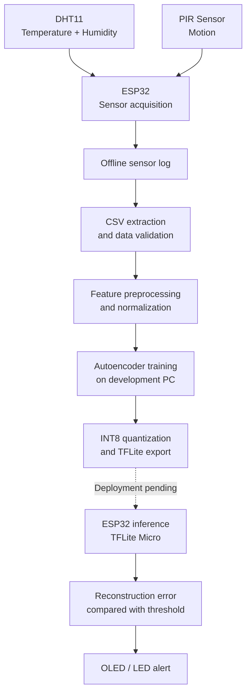

# TinyML Environmental Anomaly Detection on ESP32

**An embedded machine-learning project for detecting unusual indoor environmental behavior using real sensor data and a lightweight autoencoder.**

The project explores how far a small neural network can go on a resource-constrained microcontroller, from sensor acquisition and offline model development to INT8 quantization and eventual on-device inference.

> **Current stage:** Real-data collection, model training, and INT8 conversion are complete for the current experimental pipeline. On-device inference and labeled anomaly evaluation remain in progress.

## Project at a glance

| | |
|---|---|
| **Platform** | ESP32 development board |
| **Sensors** | DHT11 temperature/humidity sensor, HC-SR501 PIR motion sensor |
| **ML approach** | Unsupervised reconstruction-based anomaly detection |
| **Model** | Dense autoencoder, `3 → 8 → 2 → 8 → 3` |
| **Model parameters** | 101 trainable parameters |
| **Deployment format** | INT8 TensorFlow Lite model |
| **Dataset** | Real sensor readings collected using the ESP32 |
| **Cloud dependency** | None required by the intended local-inference design |
| **Current limitation** | On-device inference has not yet been validated |

## Why this project?

Environmental monitoring is often implemented using fixed thresholds: trigger an alert when temperature exceeds a limit, humidity becomes too high, or motion is detected.

These rules are useful, but they depend on predefined conditions and may miss unusual combinations of sensor readings.

This project investigates a different approach: learn a representation of typical environmental behavior from normal operating data, then use reconstruction error to identify observations that differ from the learned patterns.

The engineering challenge is not only to train a model. It is also to collect reliable data, establish a defensible anomaly threshold, evaluate false alarms, reduce model size through quantization, and determine whether the resulting model can run within an ESP32's resource constraints.

## System architecture

The intended end-to-end pipeline is shown below. The diagram distinguishes the existing data and model-development workflow from the remaining deployment work.



The current workflow supports real sensor acquisition, offline data extraction, training, and INT8 model conversion. The complete on-device inference and alerting path remains a development target until it has been implemented and tested on the hardware.

## Hardware

| Component | Purpose | Interface |
|---|---|---|
| ESP32 DevKit | Sensor acquisition and target inference platform | — |
| DHT11 module | Temperature and relative humidity | GPIO 4 |
| HC-SR501 PIR | Motion detection | GPIO 27 |
| SSD1306 128×64 OLED | Intended status display | I²C, GPIO 21/22 |
| LED with 220 Ω resistor | Intended visual indicator | GPIO 26 |

The original design considered an LDR light sensor, but a usable module was unavailable. The current model therefore uses three features: temperature, humidity, and motion.

See [`docs/wiring.md`](docs/wiring.md) for the wiring details and design notes.

## Machine-learning approach

### Input features

Each observation contains three features:

- `temp_c` — temperature in degrees Celsius.
- `hum_pct` — relative humidity in percent.
- `motion` — binary motion indication for the sampling window.

The current sampling interval is five seconds. Motion is represented as a binary event within the window rather than as a detailed movement signal.

### Autoencoder architecture

```text
Input (3)
   │
   ▼
Dense (8)
   │
   ▼
Latent representation (2)
   │
   ▼
Dense (8)
   │
   ▼
Reconstruction (3)
```

The two-unit latent representation compresses the three input features. During training, the network learns to reconstruct observations from the training distribution.

At inference time, the intended anomaly score is the mean squared reconstruction error:

\[
\operatorname{MSE}(x,\hat{x}) =
\frac{1}{3}\sum_{i=1}^{3}(x_i-\hat{x}_i)^2
\]

An observation is flagged when its reconstruction error exceeds a threshold, \(\tau\).

The current threshold is defined using the 95th percentile of reconstruction errors on held-out validation data. This is a calibration rule, not a guarantee of a 5% false-positive rate on future data.

### Training and quantization

The model is trained on a development computer using real sensor readings. The trained model is then converted to an INT8 TensorFlow Lite artifact.

Normalization parameters and the threshold must be kept consistent with the model and its quantized representation. The INT8 model requires its own appropriate threshold calibration; the floating-point threshold must not be substituted without evaluation.

The eventual embedded implementation is intended to use TensorFlow Lite Micro, with no cloud service required for inference.

For additional methodology and implementation details, see [`docs/methodology.md`](docs/methodology.md).

## Experimental results

The following results are from the current real-data training and conversion experiment.

### Dataset and training

| Metric | Result |
|---|---:|
| Usable observations | 6,913 |
| Total recorded duration | Approximately 9.6 hours across sessions |
| Training observations | 5,040 |
| Validation observations | 1,080 |
| Test observations | 793 |
| Training epochs completed | 124 |
| Best validation loss | \(1.16 \times 10^{-3}\) |
| Trainable parameters | 101 |

The dataset was assembled from multiple real sensor sessions. The recorded duration is not a full day/night cycle, and the data does not yet provide a comprehensive labeled anomaly benchmark.

### INT8 conversion

| Metric | Result |
|---|---:|
| INT8 TFLite file size | 3,440 bytes |
| Floating-point validation error, median | \(8.26 \times 10^{-5}\) |
| INT8 validation error, median | \(2.10 \times 10^{-3}\) |
| Floating-point validation error, 95th percentile | \(4.54 \times 10^{-3}\) |
| INT8 validation error, 95th percentile | \(5.73 \times 10^{-3}\) |
| Per-sample error correlation, float vs INT8 | 0.9219 |

Quantization successfully produced an INT8 model artifact. However, the difference between floating-point and INT8 reconstruction errors shows why the quantized model needs independent threshold calibration and evaluation.

The 3,440-byte figure is the model file size only. It does not represent total firmware size, runtime memory usage, TensorFlow Lite Micro arena requirements, or measured inference latency.

### Current evaluation: a limitation to address

The current floating-point model produced a **28.2% false-positive rate on the held-out normal test observations**, using the threshold calibrated on the validation set.

This is substantially higher than desired. The model is therefore not yet demonstrated to be a reliable anomaly detector.

Potential next steps include collecting more representative normal data, investigating environmental drift and session differences, validating threshold stability, and comparing the autoencoder with simpler baselines such as PCA and Mahalanobis distance.

No detection-rate or anomaly-recall claim is made yet because a labeled real-world anomaly evaluation has not been completed.

## Repository structure

```text
tinyml-env-anomaly/
├── firmware/
│   └── data_logger/       # ESP32 sensor acquisition firmware
├── ml/
│   ├── train_autoencoder.py
│   └── convert_tflite.py
├── tools/
│   ├── offline_dump.py   # Extract stored sensor readings
│   ├── check_session.py  # Inspect recorded sessions
│   └── fake_esp32.py     # Synthetic development data only
├── docs/
│   ├── wiring.md
│   └── methodology.md
├── data/
│   ├── raw/              # Local sensor recordings
│   └── synthetic/        # Synthetic development data
├── models/               # Generated model artifacts
├── requirements.txt
└── README.md
```

Generated datasets and model artifacts may be excluded from version control. Check the repository's `.gitignore` before assuming these files are tracked.

## Reproducing the current experiment

The commands below reflect the current offline-data workflow. Replace paths or options only if they differ from the checked-in scripts.

### 1. Set up the Python environment

The current experiment used Python 3.12.10 and TensorFlow 2.21.0.

```powershell
py -3.12 -m venv .venv
.venv\Scripts\Activate.ps1
python -m pip install --upgrade pip
pip install -r requirements.txt
```

### 2. Extract stored ESP32 readings

Connect the ESP32 and identify its serial port. For example:

```powershell
python tools/offline_dump.py --port COM4 --out data/raw/session.csv
```

The optional `--start` argument can be used to anchor timestamps to the actual recording start time when it is known:

```powershell
python tools/offline_dump.py --port COM4 --start "YYYY-MM-DD HH:MM:SS" --out data/raw/session.csv
```

Replace the date and time with the actual local recording start time. Without `--start`, the tool warns that the generated timestamps are approximate.

**Data safety:** Do not use `--erase` until the stored readings have been successfully extracted and the resulting CSV has been verified and backed up.

### 3. Validate a recorded session

```powershell
python tools/check_session.py data/raw/session.csv
```

Review the row count, timing gaps, reboot detection, missing fields, and sensor ranges before using the data for training.

### 4. Train the autoencoder

Example using multiple recorded sessions:

```powershell
$files = @(
    "data/raw/session_20261024_234018.csv",
    "data/raw/session_20261025_134557.csv",
    "data/raw/classroom_raw_20261026.csv",
    "data/raw/session_20261026_105615_reading_room.csv"
)

python ml/train_autoencoder.py --train $files --outdir models/scratch
```

Use the exact session paths available in your local dataset. The command above reproduces the current experiment only when those files are present.

### 5. Convert and evaluate the INT8 model

```powershell
python ml/convert_tflite.py --train $files --model-dir models/scratch
```

The current conversion workflow produces an INT8 TFLite model and associated parameter and threshold artifacts. Conversion success confirms that the artifact was generated; it does not establish that inference is already running on the ESP32.

## Current status and roadmap

- [x] Wire the sensors and bring up the acquisition hardware.
- [x] Implement ESP32 sensor-data logging.
- [x] Extract real readings from the device's offline log.
- [x] Validate recorded CSV sessions.
- [x] Train the three-feature autoencoder on real sensor data.
- [x] Generate an INT8 TFLite model artifact.
- [x] Measure floating-point versus INT8 reconstruction-error differences.
- [ ] Collect a longer and more representative normal dataset.
- [ ] Record controlled disturbances with event timestamps and labels.
- [ ] Evaluate false positives and detection performance on labeled data.
- [ ] Compare the autoencoder with PCA and Mahalanobis baselines.
- [ ] Implement and validate TensorFlow Lite Micro inference on the ESP32.
- [ ] Verify on-device preprocessing, quantization, thresholding, and alert behavior.
- [ ] Measure runtime memory usage and inference latency.
- [ ] Investigate the value of adding a light sensor when hardware becomes available.

## Known limitations

- **Limited sensors:** The current model uses temperature, humidity, and binary motion only. Light-level context is unavailable.
- **DHT11 resolution:** The sensor provides relatively coarse temperature and humidity measurements, which limits the detail available to the model.
- **Limited collection duration:** The current dataset covers approximately 9.6 hours across sessions, not a complete day/night cycle.
- **High false-positive rate:** The current held-out normal test false-positive rate is 28.2%; threshold stability and generalization require improvement.
- **No labeled anomaly benchmark yet:** Controlled, timestamped disturbances are needed to measure detection performance meaningfully.
- **No verified embedded inference yet:** The INT8 artifact has been generated, but inference, runtime memory usage, latency, and alert behavior have not yet been validated on the ESP32.
- **Quantization changes reconstruction error:** The INT8 model requires evaluation and calibration using its own error distribution.

## Future work

The next phase focuses on improving the quality of the evaluation rather than simply increasing model complexity:

1. Collect controlled, labeled environmental disturbances.
2. Investigate false positives across sessions and environmental drift.
3. Compare the autoencoder against lightweight statistical baselines.
4. Validate floating-point and INT8 behavior on the target hardware.
5. Measure the actual embedded resource footprint.
6. Evaluate whether additional sensing improves detection enough to justify the hardware cost.

The goal is a reproducible, resource-conscious embedded ML system whose performance is measured on real sensor data and whose deployment constraints are documented explicitly.
