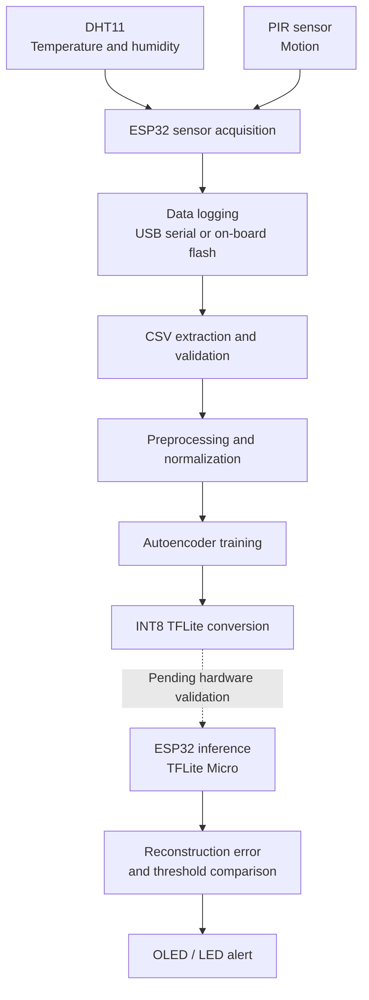

# TinyML Environmental Anomaly Detection on ESP32

**An embedded machine-learning project exploring unsupervised environmental anomaly detection under microcontroller constraints.**

This project combines real sensor-data acquisition, lightweight neural-network training, INT8 quantization, and an ESP32-based deployment workflow. The objective is to identify unusual indoor environmental observations from temperature, humidity and motion data, without cloud inference and without labeled anomalies during training.

> **Project status:** Real sensor-data acquisition, model training and INT8 conversion have been completed for the current experiment. Reliable anomaly detection and on-device inference have **not** yet been validated.

## Overview

| Category | Details |
|---|---|
| Target platform | ESP32 development board |
| Sensors | DHT11 temperature/humidity, HC-SR501 PIR |
| Input features | Temperature, relative humidity, motion |
| ML approach | Unsupervised reconstruction-based anomaly detection |
| Architecture | Dense autoencoder: `3 → 8 → 2 → 8 → 3` |
| Trainable parameters | 101 |
| Quantization | INT8 TensorFlow Lite |
| Current INT8 model size | 3,440 bytes (model file only) |
| Training data | Real readings recorded with the ESP32 (9.6 hours, 4 sessions) |
| Intended inference | Local execution using TensorFlow Lite Micro |
| Cloud dependency | None intended for inference |

## Why this project?

Environmental monitoring often relies on fixed thresholds, such as an alert when temperature exceeds a limit. Independent thresholds do not capture every unusual pattern across several sensor signals.

This project investigates whether a compact autoencoder can learn typical environmental observations and flag deviations through reconstruction error. The challenge extends beyond model training: an embedded system must also handle sensor acquisition, preprocessing, threshold calibration, quantization effects, memory limits and false alarms.

The work therefore follows an experimental workflow: collect real data, train and evaluate a compact model, convert it to INT8, and validate it on the target hardware.

## System architecture



**Implemented:** sensor acquisition, data logging, data extraction, session inspection, model training and INT8 model conversion.

**In progress:** validated on-device inference, embedded anomaly scoring, alert behavior and end-to-end evaluation. The OLED and LED are part of the intended design; their integration with the inference pipeline is not claimed as validated.

## Hardware

| Component | Purpose | Interface |
|---|---|---|
| ESP32 DevKit | Sensor acquisition and target inference platform | — |
| DHT11 module | Temperature and relative humidity | GPIO 4 |
| HC-SR501 PIR | Motion detection | GPIO 27 |
| SSD1306 128×64 OLED | Intended status display | I²C, GPIO 21/22 |
| LED with 220 Ω resistor | Intended visual indicator | GPIO 26 |

The initial design included an LDR light sensor, but no usable module was available, so the current implementation uses three input features instead of four. See [`docs/wiring.md`](docs/wiring.md) for wiring details.

### Firmware

| Sketch | Purpose |
|---|---|
| `firmware/data_logger/data_logger.ino` | Streams one CSV row every 5 s over USB serial; recorded on the PC with `tools/serial_logger.py` |
| `firmware/offline_logger/offline_logger.ino` | Stores checksummed records in the ESP32's flash so the board can log without a PC; extracted afterwards with `tools/offline_dump.py` |

## Dataset

All data was recorded with this hardware, one sample every five seconds.

| Session file | Date | Logging method | Usable rows | Setting |
|---|---|---|---:|---|
| `session_20261024_234018.csv` | 24 Oct 2026, night | USB serial | 941 | Quiet private room |
| `session_20261025_134557.csv` | 25 Oct 2026, afternoon | USB serial | 1,772 | Quiet private room |
| `classroom_raw_20261026.csv` | 26 Oct 2026 | On-board flash | 900 | Occupied room |
| `session_20261026_105615_reading_room.csv` | 26 Oct 2026, 10:56–15:33 | On-board flash | 3,300 | Occupied reading room |

Usable rows are counted after discarding the first 12 samples after every reboot. Notes:

- Humidity in the reading-room session fell steadily from about 43% to 29% over 4.6 hours.
- In the second session, 25 `t_ms` values were damaged in transit over USB serial; the measurements themselves were intact. The offline logger avoids this class of error by checksumming each stored record.
- `classroom_raw_20261026.csv` was extracted without a start time, so its clock timestamps are approximate. Training does not use clock time.
- A later full dump of the board's flash is a superset of the reading-room session and is deliberately not used for training, to avoid duplicate rows.

## Machine-learning methodology

### Input features

- `temp_c`: temperature in degrees Celsius.
- `hum_pct`: relative humidity in percent.
- `motion`: binary indication of any motion within the 5-second window.

### Autoencoder architecture

```text
Input (3 features)
       │
       ▼
   Dense (8)
       │
       ▼
 Latent space (2)
       │
       ▼
   Dense (8)
       │
       ▼
Output (3 features)
```

The autoencoder learns to reconstruct observations from the training distribution. Its two-unit bottleneck compresses the three inputs into a lower-dimensional representation.

The anomaly score is the mean squared reconstruction error over the three normalized features:

```text
MSE(x, x̂) = (1/3) · Σ (xᵢ − x̂ᵢ)²      for i = 1..3
```

An observation is flagged when its score exceeds a threshold τ.

### Data split and threshold calibration

Each session is cut into contiguous 15-minute blocks, which are assigned 70 / 15 / 15 to training, validation and test sets. The threshold is the 95th percentile of the reconstruction error on the validation blocks. Because neighbouring blocks are correlated, this test is optimistic about generalization to new days; a held-out whole-session evaluation is planned.

The 95th percentile is a calibration choice, not a guarantee that future normal observations will have a 5% false-positive rate. The INT8 model has a different error distribution and needs its own threshold.

### Training and quantization

Training takes place on a computer using the recorded data. The trained model is converted to INT8 with a representative dataset, and the threshold is recomputed on the quantized model. The on-device pipeline must apply the same normalization parameters, handle quantization and dequantization, compute the reconstruction error and compare it with the INT8 threshold. TensorFlow Lite Micro is the intended runtime; running the model on the ESP32 remains a separate validation task.

See [`docs/methodology.md`](docs/methodology.md) for details.

## Preliminary results

These results come from the four sessions above (9.6 hours) and are not a final evaluation.

### Training

| Metric | Result |
|---|---:|
| Usable observations | 6,913 |
| Training / validation / test | 5,040 / 1,080 / 793 |
| Training epochs | 124 |
| Best validation loss | 1.16 × 10⁻³ |

### INT8 conversion

| Metric | Float model | INT8 model |
|---|---:|---:|
| Median validation reconstruction error | 8.26 × 10⁻⁵ | 2.10 × 10⁻³ |
| 95th-percentile validation error (threshold) | 4.54 × 10⁻³ | 5.73 × 10⁻³ |
| Model file size | — | 3,440 bytes |

The per-sample error correlation between the float and INT8 models is 0.9219. Quantization raised the typical error substantially, so the INT8 model needs its own threshold. The 3,440 bytes is the model file only; it excludes firmware size, tensor-arena memory and inference latency, none of which has been measured yet.

### False alarms on normal data

The held-out normal test set gave a **28.2% false-positive rate** for the float model and also 28.2% for the INT8 model with its own threshold (30.1% if the float threshold is reused). This is too high for a reliable detector.

The false alarms are not spread evenly. The three test blocks from the occupied-room session exceeded the threshold 5–6% of the time, close to the 5% target, while the last two test blocks (the final ~21 minutes of the reading-room session) exceeded it 67% and 100% of the time. That period is also the driest air in the dataset (mean humidity about 31% and 29% in its last two 15-minute blocks, versus 32% or higher in all earlier blocks). This is consistent with drift beyond the range seen in training, but it has not been verified.

No detection rate or recall is reported, because a labeled real-world anomaly evaluation has not been completed.

## Repository structure

```text
tinyml-env-anomaly/
├── firmware/
│   ├── data_logger/data_logger.ino
│   └── offline_logger/offline_logger.ino
├── ml/
│   ├── train_autoencoder.py
│   └── convert_tflite.py
├── tools/
│   ├── serial_logger.py     # record rows streamed over USB serial
│   ├── offline_dump.py      # extract rows stored in the board's flash
│   ├── reanchor_session.py  # fix timestamps of a dump made without --start
│   ├── check_session.py     # data-quality report for a session CSV
│   └── fake_esp32.py        # synthetic data generator (development only)
├── docs/
│   ├── methodology.md
│   └── wiring.md
├── data/raw/                # recorded sessions and notes
├── requirements.txt
└── README.md
```

Models are generated locally and not tracked. Synthetic data from `tools/fake_esp32.py` is for development only and must never be presented as real measurements.

## Reproducing the current experiment

### 1. Set up the environment

Tested with Python 3.12.10 and TensorFlow 2.21.0.

```powershell
py -3.12 -m venv .venv
.venv\Scripts\Activate.ps1
python -m pip install --upgrade pip
pip install -r requirements.txt
```

### 2. Record data

**Option A: USB serial.** Flash `data_logger.ino`, then:

```powershell
python tools/serial_logger.py --port COM4
```

**Option B: standalone.** Flash `offline_logger.ino` and power the board from USB or a power bank. Note the exact time you power it on, then extract the rows:

```powershell
python tools/offline_dump.py --port COM4 --start "YYYY-MM-DD HH:MM:SS" --out data/raw/session.csv
```

Use the real local date and time of power-on. Without `--start`, timestamps are approximate.

> **Important:** do not run `serial_logger.py` with the offline firmware. It only captures status lines, and the readings stay in the board's flash.
>
> **Data safety:** avoid `--erase` until the exported CSV has been checked and backed up. It erases the board's stored log, not the CSV.

### 3. Inspect a recording

```powershell
python tools/check_session.py data/raw/session.csv
```

Review row count, timing gaps, reboots, missing fields and sensor ranges before using a session.

### 4. Train the autoencoder

```powershell
$files = @(
    "data/raw/session_20261024_234018.csv",
    "data/raw/session_20261025_134557.csv",
    "data/raw/classroom_raw_20261026.csv",
    "data/raw/session_20261026_105615_reading_room.csv"
)

python ml/train_autoencoder.py --train $files --outdir models/scratch
```

Results should be close to those reported above; small numerical differences are possible between machines and TensorFlow builds.

### 5. Convert to INT8

```powershell
python ml/convert_tflite.py --train $files --model-dir models/scratch
```

This writes `model_int8.tflite`, `thresholds_int8.json`, `model_data.h` and `model_params.h` to the model directory. Successful conversion does not verify on-device inference.

## Development roadmap

- [x] Sensor wiring and hardware bring-up
- [x] Sensor-data logging (USB serial and standalone)
- [x] Extraction and validation of recorded sessions
- [x] Training a three-feature autoencoder on real data
- [x] INT8 TensorFlow Lite conversion with a recomputed threshold
- [ ] Controlled disturbances with event timestamps and labels
- [ ] Detection rate and false-alarm evaluation on labeled data
- [ ] Comparison with PCA and Mahalanobis baselines
- [ ] Whole-session hold-out evaluation and drift investigation
- [ ] TensorFlow Lite Micro inference on the ESP32
- [ ] On-device preprocessing, thresholding and alert behavior
- [ ] Measured memory use and inference latency
- [ ] Benefit of adding a light sensor

## Known limitations

- **Limited sensor set:** temperature, humidity and binary motion only; no light context.
- **Sensor resolution:** the DHT11 is coarse (about ±2 °C and ±5 %RH accuracy; humidity in 1 %RH steps).
- **Limited data:** 9.6 hours across four sessions, with no complete day/night cycle.
- **Environmental drift:** one session shows humidity falling out of the range seen in training, and the model does not currently handle this.
- **Optimistic test split:** neighbouring blocks of the same session end up in different sets.
- **High false-positive rate:** 28.2% on held-out normal data, so reliable detection has not been demonstrated.
- **No labeled anomaly benchmark yet:** no recall or detection rate is reported.
- **No verified on-device inference:** the exported INT8 model has not been run on the ESP32.
- **Unmeasured embedded resources:** firmware size, tensor-arena memory and latency are unknown.
- **Quantization effects:** INT8 conversion changes the error distribution and needs its own threshold.

## Future work

1. Collect and label controlled environmental disturbances.
2. Investigate false positives across sessions and drift.
3. Compare the autoencoder with lightweight statistical baselines.
4. Validate float and INT8 behavior on the target hardware.
5. Measure the real embedded memory and latency footprint.
6. Evaluate whether additional sensing is worth its hardware cost.